# ARIA: Adaptive Routing and Inventory Allocation

**Every evening, ARIA decides which depot sends which product to which town, then makes sure the delivery really reached the shop.**

ARIA is a mobile app for FMCG distributors and super-stockists, built for Android, iOS and the web. The planner runs on the phone itself, so a distributor with no server and a weak signal can still plan the night. A small free Firebase project carries only the team: accounts, trips, delivery proof and plan files.

<p align="center">
  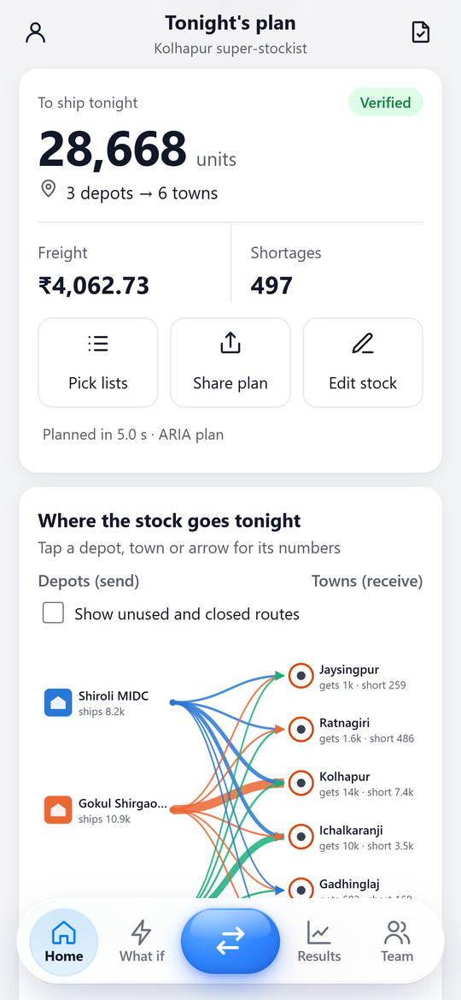
  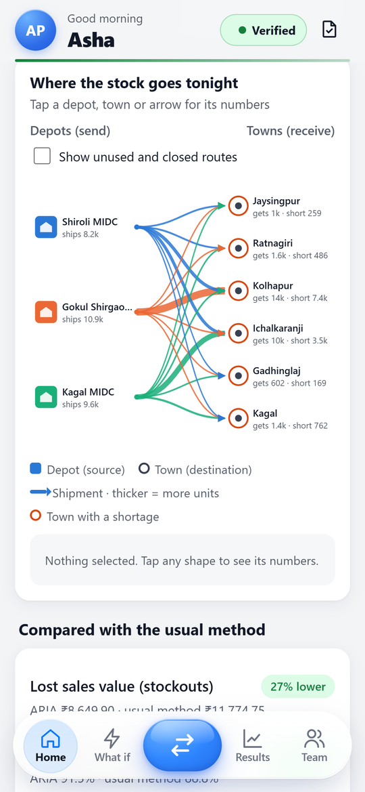
  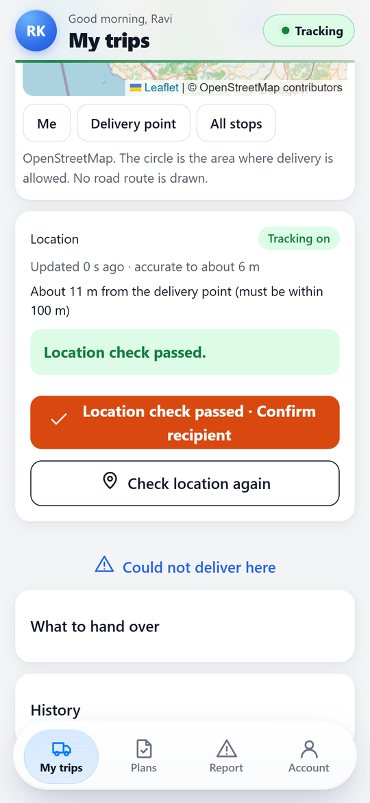
</p>

---

## What it does

| | |
|---|---|
| **Plans tonight's shipments** | It forecasts demand per town and product as calibrated ranges, not one guess. It prices freight into each route's service level, then allocates stock lot by lot (HiGHS) so nothing arrives with too little shelf life. |
| **Checks every plan** | An independent verifier tests 8 safety rules (stock, capacity, shelf life, routes and more) before a plan is shown or shared. |
| **Compares with the usual method** | Each plan sits beside the common rule "forecast plus a fixed buffer from the nearest depot": lost sales, fill rate, freight and wastage. |
| **Answers "what if"** | Demand up 20%, a depot loading less, a route closed: each scenario is planned and compared with today. |
| **Scans stock labels** | Point the camera at a QR code or retail barcode. ARIA checks the lot against the data, refuses what cannot be right, updates the stock and plans again. |
| **Proves deliveries (GeoProof)** | "Delivered" unlocks only when the driver's phone is at the shop. The shop's one-time code and the admin's confirmation complete it. |
| **Locks plan files** | Plans travel as `.svcr` files, locked (AES-256-GCM) to the team. Forwarded outside the team they cannot be read, and every opened file is checked again. |
| **Works offline** | Planning, plan files and the full safety check run without internet. Team data syncs when the phone is back online. |

All data enters through **one CSV file** (products, depots, towns, routes, stock, and demand or past sales). See [`csv-format.md`](mob-apk/docs/csv-format.md).

---

## Screenshots

### The admin: plan tonight

<table>
  <tr>
    <td align="center">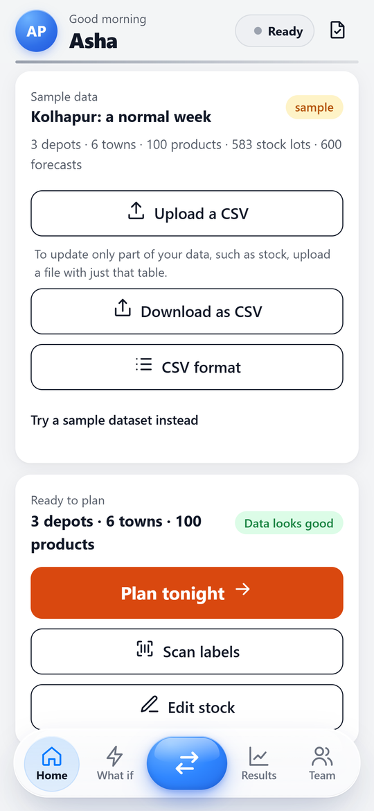<br><sub><b>Load data</b>: one CSV, checked row by row</sub></td>
    <td align="center"><br><sub><b>Tonight's plan</b>: verified before it is shown</sub></td>
    <td align="center"><br><sub><b>Where the stock goes</b>: tap any depot, town or arrow</sub></td>
    <td align="center">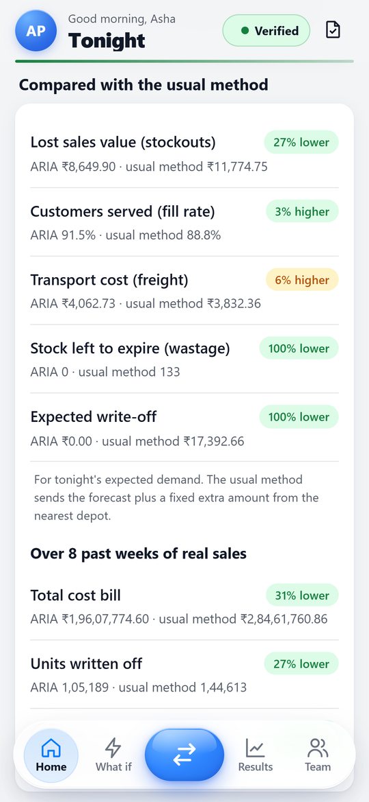<br><sub><b>Against the usual method</b>: tonight and 8 past weeks</sub></td>
  </tr>
  <tr>
    <td align="center">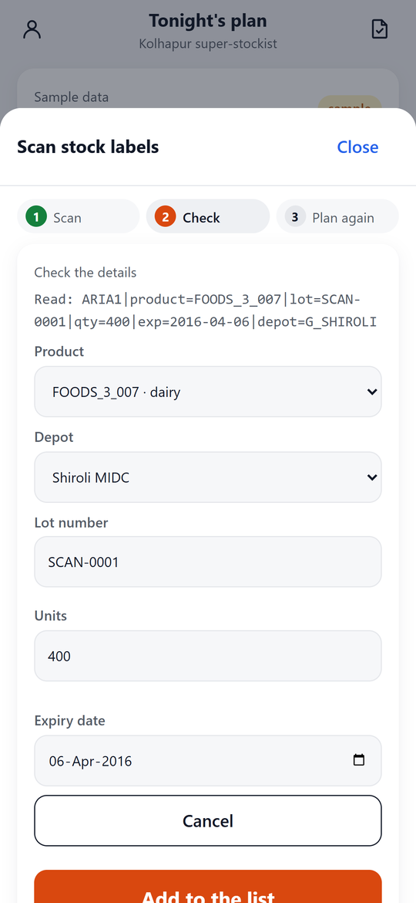<br><sub><b>Scan a label</b>: every field checked against the data</sub></td>
    <td align="center">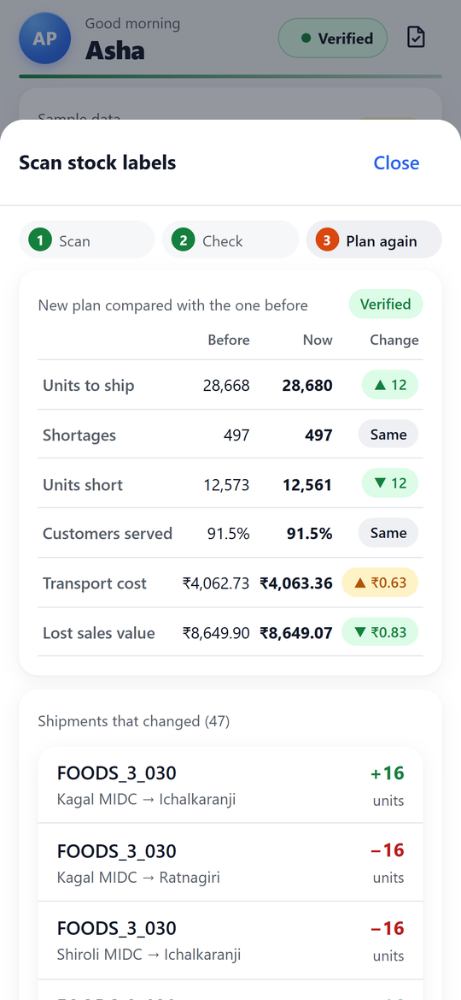<br><sub><b>Plan again</b>: the new plan against the old one</sub></td>
    <td align="center">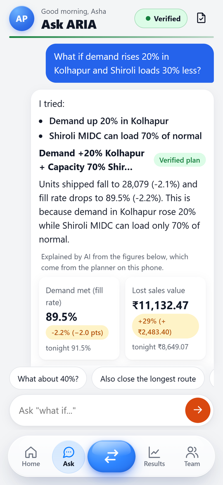<br><sub><b>Ask ARIA</b>: a what-if question answered</sub></td>
    <td align="center">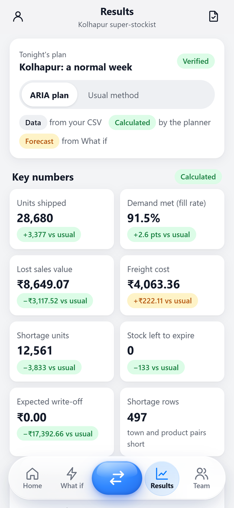<br><sub><b>Results</b>: key numbers and charts</sub></td>
  </tr>
</table>

### The team: send trips and follow every delivery

<table>
  <tr>
    <td align="center">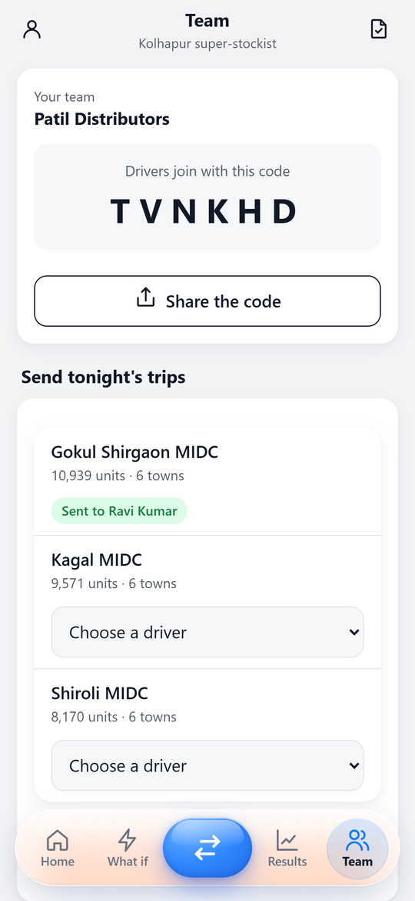<br><sub><b>Team</b>: drivers join with a 6-letter code; one trip per depot</sub></td>
    <td align="center">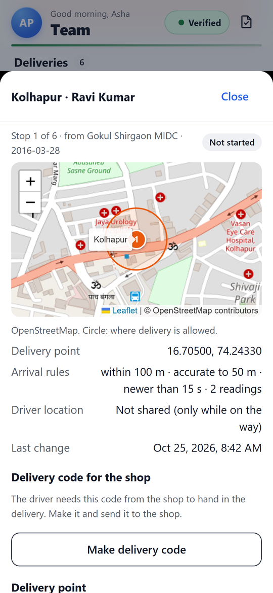<br><sub><b>A delivery stop</b>: map, delivery circle and arrival rules</sub></td>
    <td align="center">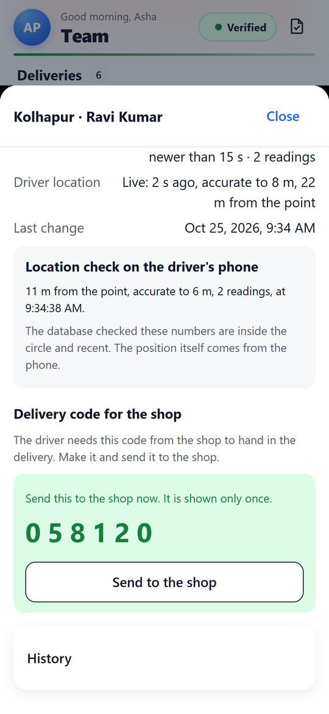<br><sub><b>Shop code</b>: shown once; only its salted hash is stored</sub></td>
    <td align="center">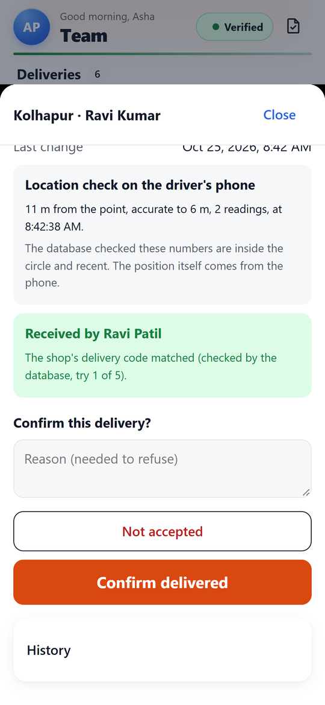<br><sub><b>Confirm</b>: the evidence, then confirm or refuse</sub></td>
  </tr>
</table>

### The driver: deliver with proof

<table>
  <tr>
    <td align="center">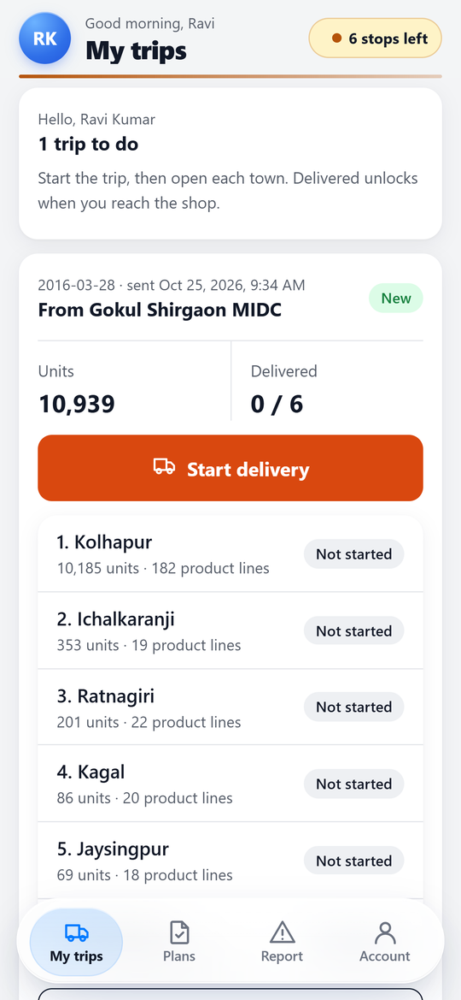<br><sub><b>My trips</b>: only what the admin sent</sub></td>
    <td align="center">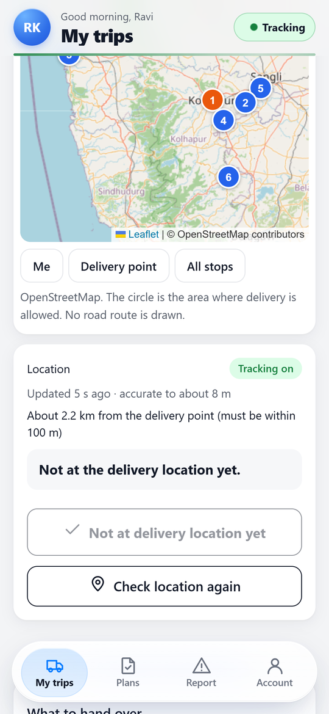<br><sub><b>On the way</b>: locked while 2 km away</sub></td>
    <td align="center"><br><sub><b>At the shop</b>: 2 precise readings unlock it</sub></td>
    <td align="center">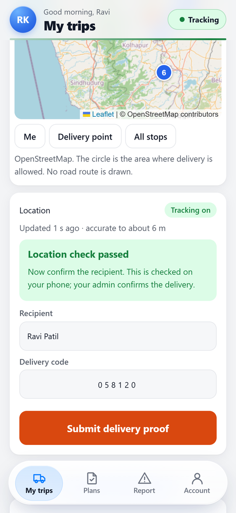<br><sub><b>Proof</b>: recipient's name and the shop's code</sub></td>
  </tr>
  <tr>
    <td align="center">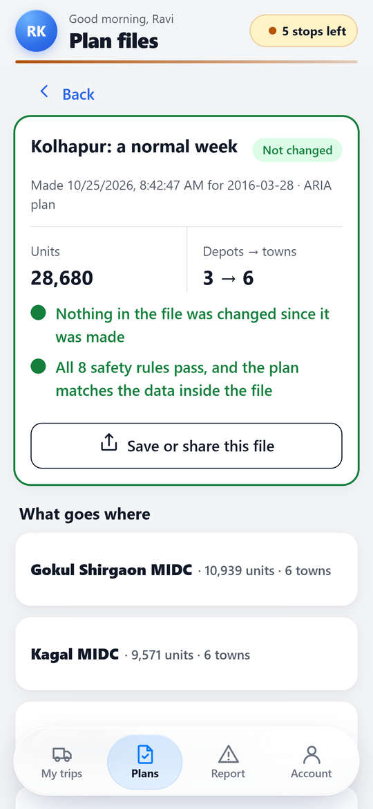<br><sub><b>Plan file</b>: all 8 safety rules re-checked on the phone</sub></td>
    <td align="center">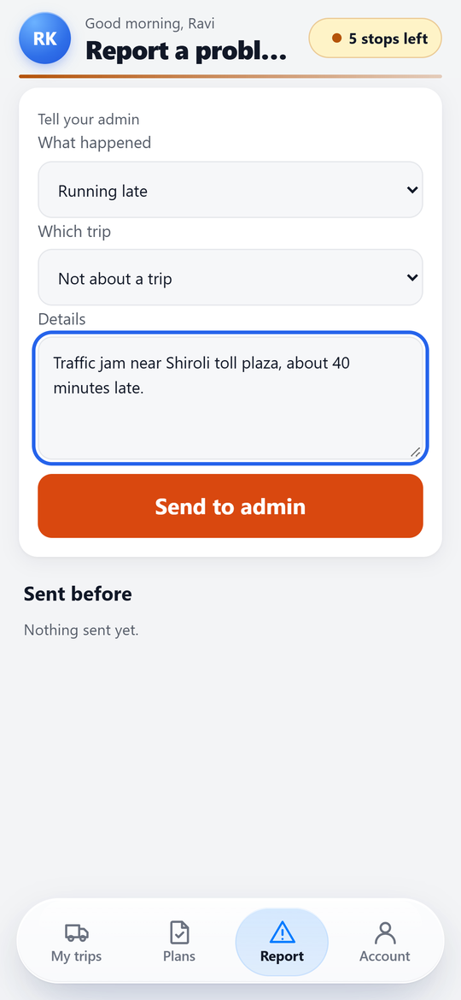<br><sub><b>Report a problem</b>: saved even offline</sub></td>
    <td align="center">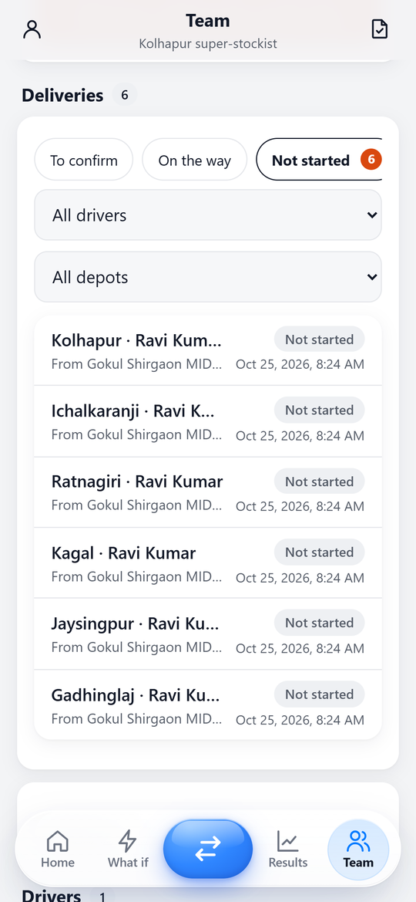<br><sub><b>Deliveries</b>: by state, driver and depot</sub></td>
    <td align="center">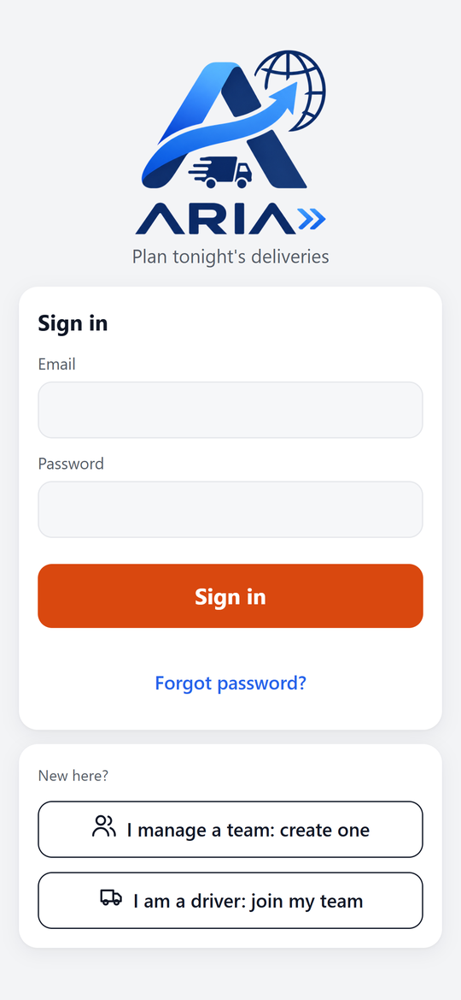<br><sub><b>Sign in</b>: admin or driver</sub></td>
  </tr>
</table>

<sub>The screenshots use the bundled Kolhapur sample and test accounts in the Firebase emulators. Regenerate them with `npm run screenshots` in `mob-apk/`.</sub>

---

## How a night works

```
Admin (evening)                                   Driver (on the road)
──────────────                                    ────────────────────
Load the CSV (or scan new stock labels)
Plan tonight ── verified by 8 safety rules
Send each depot's load to a driver ─────────────▶ Start the trip, open a stop
                                                  "Delivered" stays locked until the phone
                                                  is inside the shop's circle (100 m,
                                                  accurate to 50 m, 2 fresh readings)
Make the shop's delivery code ── to the shop ───▶ Enter the recipient's name and code
                                                  (checked by the database, at most 5 tries)
Confirm or refuse the delivery ◀──────────────── Awaiting confirmation
```

GPS comes from the phone and can be faked, so the app never treats the driver's step as final: the admin confirms every delivery. The limits and the upgrade path to a trusted server are in [`geoproof.md`](mob-apk/docs/geoproof.md).

---

## Results

Measured by replaying 8 held-out weeks of real sales on the Kolhapur network (3 depots, 6 towns, 100 products). Every policy starts from the same stock and faces the same demand. Full method and tables: [`results.md`](mob-apk/docs/results.md).

| | Usual method (rule-based) | **ARIA** |
|---|---|---|
| Total bill (freight + holding + write-off + lost margin) | ₹284.6 lakh | **₹196.1 lakh** |
| Fill rate | 0.935 | **0.960** |
| Cost per unit sold | | **₹9.07 lower** (95% CI entirely below 0) |
| Units written off | | **39,424 fewer** (95% CI entirely below 0) |

One check fails: when every route is priced at 6-ton truck rates, ARIA's lead over a single global service level is no longer significant (KPI-10). It is reported as measured, not hidden.

---

## Try it

- **Android:** build the APK (below) or ask the team for a build. Then create a team as admin, or join one as a driver with the team's 6-letter code.
- **Web:** the same app runs in a browser (`npm run dev` in `mob-apk/`).
- **Sample data:** on Home, *Try a sample dataset* loads the Kolhapur network in one tap.

## Build and test

```bash
cd mob-apk
npm install
npm run dev                  # web, http://localhost:5173
npm run build && npx cap sync android && (cd android && ./gradlew assembleDebug)   # Android APK (JDK 17)
```

Tests (the emulators must be running for the last three: `npm run emulators`):

```bash
cd engine && ARIA_SOLVER=scipy python -m pytest tests app_tests -q   # planner, verifier, CSV
npm run geofence-test        # arrival check
npm run rules-test           # database rules: other teams, roles, deliveries, codes
npm run smoke                # end to end in Chrome at phone size: admin and driver, GPS simulated
```

More detail: [`mob-apk/README.md`](mob-apk/README.md).

## Repository

| Path | What |
|---|---|
| [`mob-apk/`](mob-apk/) | The app: Capacitor + TypeScript UI, the Python engine run on the phone in Pyodide |
| [`mob-apk/engine/`](mob-apk/engine/) | Forecast, allocation, verifier, CSV reader, and their tests |
| [`mob-apk/firestore.rules`](mob-apk/firestore.rules) | Who may read and change what: teams, trips, delivery stops, codes |
| [`mob-apk/docs/`](mob-apk/docs/) | Decision log ([`decision.md`](mob-apk/docs/decision.md)), [`geoproof.md`](mob-apk/docs/geoproof.md), [`svcr-format.md`](mob-apk/docs/svcr-format.md), [`csv-format.md`](mob-apk/docs/csv-format.md), [`results.md`](mob-apk/docs/results.md) |
| [`docs/screenshots/`](docs/screenshots/) | The images above |

## Team

**Team Cyberpunk**, TRIWIZATHON 2026: ruturajnalbalwar-arch · thevipulbangar · chitrangad-ram-sapate · Physics0070
